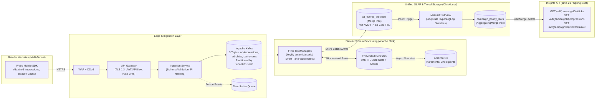
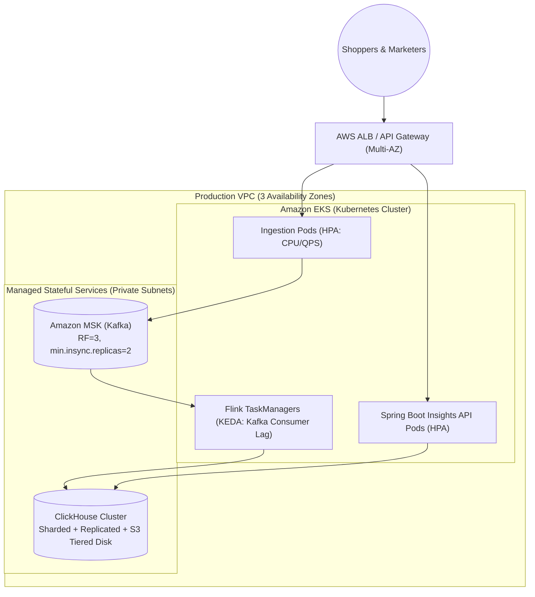

# Real-Time Retail Media & Ad-Tech Streaming Platform (dunnhumby Case Study)

## 1. Executive Summary
A multi-tenant, low-latency streaming analytics platform designed for retail media networks. It ingests high-velocity shopper interactions (`IMPRESSION`, `CLICK`, `ADD_TO_CART`), performs stateful cross-stream attribution in **Apache Flink**, stores real-time and historical rollups in **ClickHouse**, and exposes sub-50ms **Insights APIs** in **Java 21 / Spring Boot**.

## 2. End-to-End Architecture & Data Flow



## 3. Cloud Deployment Topology (Multi-AZ Kubernetes)



## 4. Cross-Cutting Concerns
* **Security & Multi-Tenancy:** TLS 1.3 in transit; KMS encryption at rest; `X-API-Key` / JWT authentication extracting `tenant_id` into request scope; `tenant_id` enforced in every Kafka partition key and ClickHouse `WHERE` predicate.
* **Observability:** Correlation ID (`X-Trace-Id`) propagation, structured JSON access logs, Spring Boot Actuator health probes (`/actuator/health`), and Prometheus metrics (`/actuator/prometheus`).
* **Scaling & Partitioning:** Kafka topics partitioned by `tenantId:userId`; KEDA scales Flink TaskManagers on Kafka consumer lag; HPA scales API pods on QPS.
* **Resilience:** Kafka `acks=all`, Flink incremental S3 checkpoints (exactly-once), DLQ for malformed events, and Resilience4j Circuit Breaker + fallback on ClickHouse reads.

## 5. Quick Start
```bash
docker-compose up --build -d
curl -H "X-API-Key: flipkart-secret-key" "http://localhost:8080/ad/camp_101/impressions"
curl -H "X-API-Key: flipkart-secret-key" "http://localhost:8080/ad/camp_101/clicks"
curl -H "X-API-Key: flipkart-secret-key" "http://localhost:8080/ad/camp_101/clickToBasket"
```
